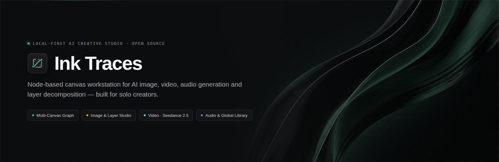
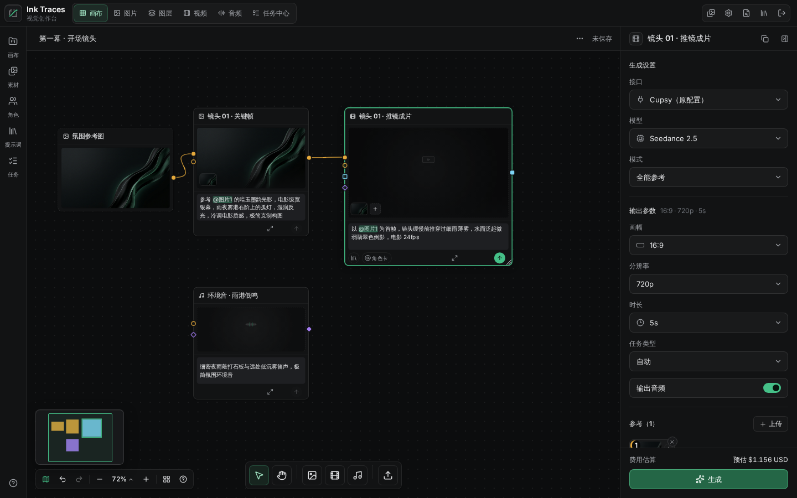

# Ink Traces WebUI

<p align="center">
  
  
  
  
  
</p>

<p align="center">
  <strong>A self-hosted, desktop-first AI image, video, audio generation and layer-editing workstation — organized as Project → Canvas → Node.</strong>
</p>

<p align="center">
  English · <a href="./doc/README.md">中文</a> · <a href="./CHANGELOG.md">Changelog</a> · <a href="./INSTALL.md">Installation Guide</a>
</p>

<p align="center">
  
</p>

<p align="center">
  
</p>

## Why Ink Traces?

Built for solo creators and developers producing multi-shot visual stories with AI media models, Ink Traces focuses on local ownership, predictable costs, and explicit node-level control:

- **Self-Hosted, Zero Subscriptions**: Runs locally on Linux or macOS with SQLite (WAL) and local media storage. Your assets, prompts, character sheets, and API credentials stay on your machine, and you pay providers directly.
- **Explicit Control & Duplicate-Billing Protection**: Nothing auto-chains behind your back—generations only run when you explicitly trigger a node, a selection, or a node group. Every image, video, and layer submission displays a 3-decimal USD pre-submit estimate, and requests that time out with an unknown outcome (`result_unknown`) are **never** automatically replayed.
- **Closed-Loop Canvas, Asset Library & Result Lifecycle**: All projects share one deduplicated global asset library referenced by ID (zero per-canvas copies). Generation history stays synchronized with task trash and deletion impact previews, while results copied into your own folders persist independently via zero-overhead hard links.
- **Web-Managed Multi-Account Interfaces, Zero Restarts**: Manage multiple BytePlus Ark and Cupsy accounts, models, and API keys directly in the browser—with masked keys, one-click same-provider key sync, safe soft deletion, and immutable revisions frozen on every submitted task.

## Core Features

### Project → Multi-Canvas → Node Workflow
- **Flat full-bleed dark studio & URL persistence**: Full-bleed desktop IDE layout with a 48px icon rail, pinnable drawers (Canvas, Library, Character Cards, Prompt Vault, Canvas Tasks), browser URL route persistence (`?project=…&canvas=…`), bottom-left minimap, undo/redo, and zoom controls.
- **Unified right properties panel & reliability guardrails**: Shared single-column properties panel across Canvas and standalone Image, Video, and Audio tools (44px neutral icon header, 36px controls with prefix icons, collapsible Advanced drawer, sticky 3-decimal USD cost estimate footer), with Seedance video-reference/extend `ratio=adaptive` guardrails, expandable/copyable sanitized errors with allowlisted fix hints, and multi-select **Run Selected**.
- **In-card prompt editing, collapsed `@` character badges & typed ports**: Edit prompts directly inside generation cards (with leading `@character` blocks collapsed to a compact 1-line badge while keeping submitted plaintext byte-exact), atomic `@图片N` / `@视频N` / `@音频N` mentions, and color-coded dynamic reference ports whose order determines video first/last frames.
- **Short-drama iteration & reuse**: Compare 2–4 node versions side-by-side (linked image zoom; muted-by-default synced video playback), mark finalized 「定稿」 versions with sidebar filtering, spawn downstream video **Extend / Edit** nodes in one click (never auto-submitting paid tasks), save reusable **Node Group Structural Templates** (`/api/canvas/templates`, zero bundled presets), and execute **Run Node Group** server-side.
- **Delivery packaging & read-only sequence preview**: Export an entire canvas as a streaming `ZIP_STORED` **Scene Export Pack** with shot-numbered media plus sanitized `shotlist.csv` / `shotlist.json` (zero credentials, signed URLs, `ep-` IDs, or host paths), or preview finalized/selected shots sequentially in the read-only in-browser **Shot Sequence Preview** modal (optional single audio track; no editing or video export).
- **Node toolbars, non-destructive video splitting & upload progress HUD**: Floating actions above image, video generation, audio, and video asset nodes—including a built-in **Video Split** modal (`ffmpeg` frame-accurate timeline cut points or equal-duration splitting into independent library segments), image edit/rotate/annotate, current/last-frame capture, preview, download, and version history popover; plus a real-time floating upload progress HUD when dropping, pasting, or uploading media onto the canvas, bulk project deletion, and automatic completed-deletion compaction + orphan disk GC.

### Global Asset Library & Result Lifecycle
- **Single global library with sub-folders & provenance filters**: Organize uploads and generated media in nested folders (default folders `音效` / `角色` / `场景` / `物品` / `风格` created once; locked system folder `生成历史` split into `图片` / `视频` / `音频` with read-only Project / Canvas / Finalized filters and sanitized hover provenance), SHA-256 deduplication, and on-demand WebP video thumbnails.
- **Synchronized task & history lifecycle**: Moving a task to Trash hides its generation-history entries; restoring the task brings them back. Permanent deletion and one-click Empty Trash preview every affected canvas, asset group, and character card before removing history originals (leaving replaceable "deleted" placeholders on referencing nodes).
- **Hard-linked independent copies**: Moving or copying a result out of generation history creates an independent library item via hard links (no extra disk space) that survives subsequent task deletion.
- **Fast canvas integration**: Global asset groups (reference collections without file copies), sidebar multi-select (`Ctrl/Cmd` / `Shift` + checkboxes) with batch move/copy/delete and multi-drag onto the canvas, cross-canvas and cross-tab automatic sidebar refresh, server-side select-all, and inline rename.
- **Character cards & built-in image editor**: Reusable **Character** and **Prop** cards (one-step image picker creation, description, up to 8 reference images, optional voice clip up to 30 s) that insert structured `@` blocks into prompts with update sync; plus a built-in canvas image editor (crop, 90° rotate, flip, brush annotation, undo/redo) that saves edits as new PNG library items without overwriting originals.

### Unified Interface Management (Web UI, No Restart)
- **Equalized provider profiles**: Initial entries from `config.json` are imported into SQLite on first startup without modifying `config.json`. All profiles are treated equally (no legacy "system default" distinction), with an optional per-type **Default Profile**（「默认配置」）toggle for first-time preselection and explicit Ark `ep-` capability declaration (`Seedream 5.5` / `Seedream 5.0 Pro`).
- **Live CRUD & zero-cost preflight**: Create, edit, enable/disable, or delete provider profiles and API keys in **Interface Management** with instant API/Worker reload and zero-cost static configuration preflight checks (`POST /api/provider-profiles[/<id>]/check`).
- **Strict credential hygiene**: API keys are masked (`••••••••`) and never echoed back in API responses; `ep-` IDs are masked in errors and ledgers; updating or clearing a key offers one-click sync across profiles of the same provider adapter.
- **Safe soft deletion & immutable revisions**: Deleting any profile frees its name for immediate reuse, records a tombstone so restarts never re-import deleted entries or fall back to stale `config.json` keys, and preserves immutable historical revisions so in-flight tasks, retries, and Cupsy asset references complete intact.

### Billing Safety, Cost Transparency & Creative Tools
- **Safe billing boundary & fine-grained task telemetry**: Timed-out requests with an unknown outcome (`result_unknown`) are never automatically replayed; signed provider URLs are never exposed to the browser. Long-running tasks display real processing stages (`uploading` → `queued` → `generating` → `downloading`), 30-day local P50 duration hints, and parallel active-task counts—never fake progress bars.
- **Cost estimates, Project Cost Ledger & soft budget alerts**: Pre-submit USD estimates (3 decimal places) across canvas, standalone tools, and Layer Studio, aggregated in a per-project ledger with human-readable profile names and optional per-project soft budget warning thresholds (non-blocking; unknown costs itemized separately, never `$0.000`).
- **Layer Studio**: Decompose images into 2–100 editable layers on BytePlus Ark Seedream 5.5 (default `max_images: 12` with range cost estimate), with Ark profile selection, automatic canvas project ledger attribution, optional OCR, version restore, full-resolution composite PNG/JPEG or ZIP + `manifest.json` export, and one-click return to the source canvas. See [doc/layer-studio.md](doc/layer-studio.md).
- **Global Task Center & Prompt Vault**: Unified cross-type task center (All / Image / Video / Audio / Layer) with server-backed search, pagination, favorites, unified trash with impact previews, bulk download, reusable saved prompts, and a fullscreen prompt editor.

## Supported Providers

| Capability | BytePlus Ark | Cupsy | Notes |
|---|---|---|---|
| **Image** | `Seedream 5.5` | `Seedream 5.0 Pro` | Reference images, presets & custom sizes, 3-decimal USD estimate |
| **Video** | `Seedance 2.0`, `Seedance 2.5` (`ep-…` endpoint ID) | `Seedance 2.5`, `Seedance 2.5 Moderated` | Image/video/audio references, first/last frame by port order, 480p/720p/1080p, 3-decimal USD estimate |
| **Audio** | — | `Seed Audio 1.0` | MP3 / WAV / OGG Opus up to 120 s, voice & audio/image references (cost shown as Unknown) |
| **Layer Decomposition** | `Seedream 5.5` (uses BytePlus image model) | — | 2–100 editable layers, optional OCR, composite PNG/JPEG & ZIP export |

> **Provider setup notes**
> - **BytePlus Seedance 2.5** requires your own Ark console endpoint ID (`ep-…`), configurable in the Web UI (**Interface Management**) or `providers.byteplus.endpoint_ids.seedance_2_5`.
> - **Cupsy** fetches reference media from a public HTTP(S) origin (`deployment.cupsy_source.base_url`, HTTPS recommended). See [doc/cupsy_compatibility.md](doc/cupsy_compatibility.md).

## Quick Start

**Requirements**: Python 3.10+, Node.js 18+, `ffmpeg` (with `ffprobe` on `PATH`), and API credentials for at least one provider (BytePlus Ark and/or Cupsy).

### 1. Create `config.json`

```bash
cp config.json.example config.json
```

`config.json` uses the v2 schema (`"config_version": 2`, git-ignored—never commit it). You only need to configure runtime and deployment settings here (ports, optional login under `auth`, and `deployment.public_base_url` / `deployment.cupsy_source.base_url` if needed):
- **Configure keys in the Web UI**: Leave `providers.*.api_key` empty if you prefer—after startup, open **Interface Management** in the browser to add or edit API keys and models without restarting.
- **Or seed via `config.json`**: Any provider keys filled before first launch are imported into SQLite automatically as editable system defaults.

Validate your configuration anytime with `python3 server/config_v2.py check`.

### 2. Install dependencies

```bash
./setup.sh
```

### 3. Start the workstation

```bash
./start.sh
```

Open **<http://localhost:4545>** in a desktop browser. Stop services cleanly with `./stop.sh`.

For detailed deployment, HTTPS/Nginx automation, and maintenance commands, see [INSTALL.md](INSTALL.md). When upgrading an existing installation, follow the [2.x → 2.2 upgrade steps](INSTALL.md#6-upgrade-an-existing-2x-installation-to-22) or the [1.x → 2.0 library migration](INSTALL.md#7-upgrade-from-1x-to-20).

## Architecture & Project Layout

Ink Traces runs as a three-part single-host stack: a **React 18 + Vite + Tailwind CSS** SPA (`client/`), a **Flask + Gunicorn** HTTP API plus an independent multi-pool background **Worker** (`server/`), backed by **SQLite (WAL)** and local media files using streaming I/O and hard-linked snapshots. See [doc/performance.md](doc/performance.md) for runtime performance details.

| Path | Contents |
|---|---|
| `client/` | React 18 + Vite + Tailwind CSS frontend (canvas, library, layer studio, task center) |
| `server/` | Flask API, independent task worker, SQLite storage, provider adapters, backend tests |
| `deploy/` | Nginx / Certbot / HTTPS helper scripts and templates |
| `scripts/` | Credential scanner (`secret-scan.sh`) and 1.x → 2.0 library migration tool |
| `doc/` | Chinese README and topic guides (`layer-studio.md`, `cupsy_compatibility.md`, `performance.md`) |
| `config.json.example` | Configuration template (`config_version: 2`) |
| `setup.sh` `start.sh` `stop.sh` `clean.sh` | Installation, service lifecycle, and cache cleanup scripts |

## Development & Testing

All automated tests run against mocked providers by default and never initiate paid API requests. Backend tests refuse to start if a local `config.json` exists in the checkout—run them from a clean checkout or worktree without `config.json`:

```bash
# Backend test suite
pip install -r server/requirements-dev.txt
pytest

# Frontend production build check
cd client && npm install && npm run build

# Frontend hot reload during development
NANOBANANA_FRONTEND_MODE=dev ./start.sh

# Scan staged changes for accidental secrets before committing
bash scripts/secret-scan.sh
```

## License

Released under the **MIT License** — see [LICENSE](LICENSE) for details.
