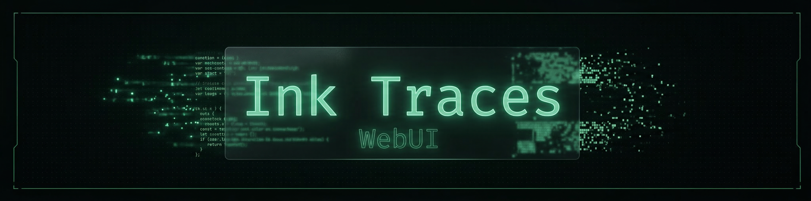
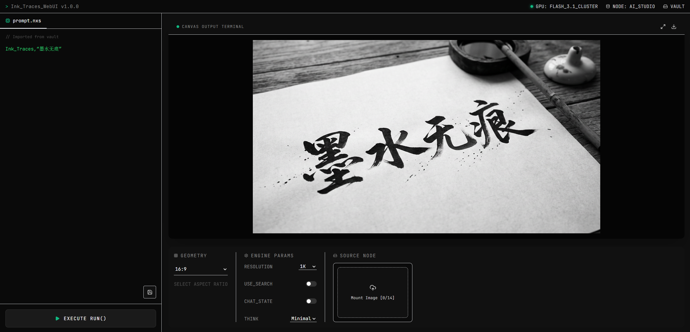

# Ink Traces WebUI

<p align="center">
  
</p>

<p align="center">
  <strong>A desktop-first AI image, video and audio generation and layer-editing workstation, organized as project → canvas → node.</strong>
</p>

<p align="center">
  English · <a href="./doc/README.md">中文</a>
</p>

<p align="center">Version 1.5.2 · <a href="./CHANGELOG.md">Changelog</a></p>

<p align="center">
  
</p>

## Features

- **Canvas workflow**: projects contain multiple canvases; image, video and audio generation nodes can be dragged, edited and wired together. Upstream results and library assets act as explicit references (including video to video). Generation only runs when you trigger it.
- **Asset library**: project assets, asset groups and local assets (your uploads are kept as independent persistent copies), with select-all and permanent delete.
- **Task center**: every generation is a real backend task with server-side search, pagination, favorites, trash and bulk download.
- **Layer studio**: decompose an image into 2–100 editable layers, optional OCR, version restore and export.
- **Interface management**: several named provider configurations; choose one per node, with project defaults and immutable revisions for submitted tasks.
- **Safe billing behavior**: if a provider request times out with an unknown outcome it is never replayed automatically, avoiding duplicate paid generations.
- **Prompt Vault**: reusable saved prompts and a fullscreen prompt editor.

## Supported providers

| Capability | Providers |
|---|---|
| Image | BytePlus Ark (Seedream 5.5), Cupsy |
| Video | BytePlus Ark (Seedance), Cupsy |
| Audio | Cupsy (Seed Audio) |
| Layer decomposition | BytePlus Ark (uses the BytePlus image model) |

## Quick start

Requirements: Python 3.10+, Node.js 18+, and API credentials for at least one provider.

```bash
cp config.json.example config.json   # then fill in your credentials
./setup.sh                           # install backend and frontend dependencies
./start.sh                           # build the frontend, start worker and Gunicorn
```

Open <http://localhost:4545>; stop with `./stop.sh`. Full instructions (HTTPS, systemd, maintenance) are in [INSTALL.md](INSTALL.md).

## Configuration notes

- Put keys only in your local `config.json`; it is git-ignored. Never commit it.
- `config.json` uses the v2 format (`"config_version": 2`): accounts under `providers.byteplus` / `providers.cupsy`, the model each capability uses under `generation`, deployment settings under `deployment`. The server refuses to start on an invalid or older file; check it with `python3 server/config_v2.py check`. See [INSTALL.md](INSTALL.md#3-configure).
- For Seedance 2.5 on Ark, set your own endpoint ID (`ep-…` from the BytePlus console) in `providers.byteplus.endpoint_ids.seedance_2_5`; the template ships a placeholder and submissions are rejected until it is replaced.
- Cupsy fetches reference media from a public HTTP(S) origin: set `deployment.cupsy_source.base_url` (HTTPS recommended). See [doc/cupsy_compatibility.md](doc/cupsy_compatibility.md).
- Set `auth.secret_key` (or `INK_TRACES_SECRET_KEY`) for controlled deployments.
- Layer workspace usage: [doc/layer-studio.md](doc/layer-studio.md). Runtime performance: [doc/performance.md](doc/performance.md).

## Development and tests

Tests use mocked providers by default and never send paid requests. Run backend tests from a checkout without `config.json`:

```bash
pip install -r server/requirements-dev.txt
pytest
cd client && npm install && npm run build   # frontend build check
```

For frontend hot reload: `NANOBANANA_FRONTEND_MODE=dev ./start.sh`.

## Project layout

| Path | Contents |
|---|---|
| `client/` | React 18 + Vite + Tailwind frontend |
| `server/` | Flask API, task worker, SQLite storage, tests |
| `deploy/` | Nginx / Certbot / HTTPS helper scripts |
| `doc/` | Chinese README and topic guides |
| `config.json.example` | Configuration template |
| `setup.sh` `start.sh` `stop.sh` `clean.sh` | Install, lifecycle and cache cleanup |

## License

Released under the MIT License; see [LICENSE](LICENSE).
