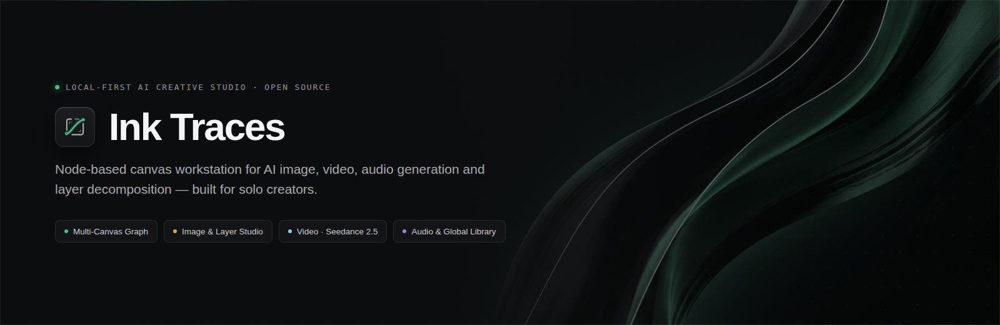
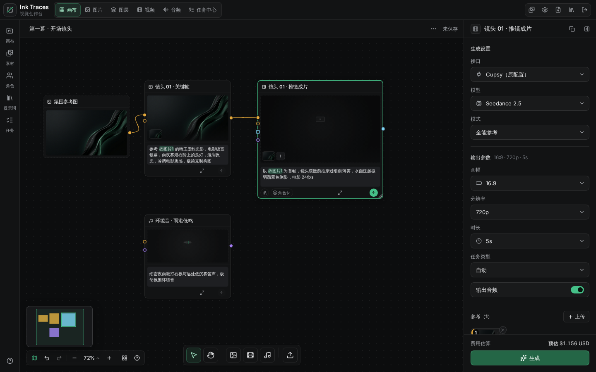

# Ink Traces WebUI

<p align="center">
  
  
  
  
  
</p>

<p align="center">
  <strong>自托管、桌面优先的 AI 图片、视频、音频生成与图层编辑工作台，按「项目 → 画布 → 节点」组织创作。</strong>
</p>

<p align="center">
  <a href="../README.md">English</a> · 中文 · <a href="../CHANGELOG.md">更新日志</a> · <a href="../INSTALL.md">安装指南</a>
</p>

<p align="center">
  
</p>

<p align="center">
  
</p>

## 为什么选择 Ink Traces？

面向需要多镜头、多素材协作创作的个人 AI 短剧创作者与开发者，Ink Traces 聚焦本地私有可控、费用透明与显式工作流：

- **本地私有部署，零平台订阅**：单机部署于 Linux / macOS，采用本地 SQLite（WAL）与本地媒体存储。素材、提示词、角色卡与 API 密钥完全掌握在自己手中，只直接向所选服务商付费。
- **显式可控，杜绝盲目烧钱**：绝不暗中连锁自动生成——只有你主动点击生成、运行所选或运行节点组时才会发起任务。图片、视频与图层分解提交前均展示 3 位小数 USD 费用预估；请求超时且结果未知（`result_unknown`）时**永不**自动重放，避免重复计费。
- **画布、素材库与任务生命周期闭环**：所有项目共用一个按内容去重的全局素材库，画布按 ID 直接引用不留冗余副本；生成历史与任务回收站、删除预览联动，而移出到其他文件夹的复制件通过硬链接独立保留且不额外占空间。
- **网页统一管理多账号 Key，改配免重启**：在浏览器内直接维护多套 BytePlus Ark 与 Cupsy 账号、模型与密钥——严格掩码不回显、支持同服务商 Key 一键同步、自定义与系统默认均可安全软删除，且已提交任务自动冻结不可变配置修订。

## 核心功能总览

### 项目 → 多画布 → 节点工作流
- **扁平暗色工作台布局**：参照 ImagineArt 风格的左侧画布/节点分区栏（紧凑项目行、可折叠画布胶囊平铺列表支持单击切换与行内重命名、可折叠节点分区带计数与搜索筛选），搭配 48px 窄图标栏与可钉住弹出面板（画布、素材库、角色卡、提示词库、本画布任务），左下角提供小地图、撤销/重做与缩放控制。
- **右侧固定属性面板**：单栏编辑接口配置、模型、分辨率、画幅、时长与高级参数，底部吸顶展示 3 位小数 USD 预估与生成按钮；框选多个节点时自动切换为**运行所选**。
- **卡片内直接编辑提示词与 `@` 提及**：任意缩放下均可直接在节点卡片内编辑提示词（亦可展开全屏编辑），支持原子化的 `@图片N` / `@视频N` / `@音频N` 引用与 `@` 角色卡/物件卡快速插入。
- **动态着色参考口与确定性顺序**：生成节点左侧按类型着色列出参考输入口（图片圆点、视频方块、音频菱形），动态呈现「已占用 + 1 个空口」直至达到模型上限；端口名称在悬停、选中或拖线时显示。口序号直接决定参考顺序，也决定视频首尾帧顺序（第 1 张为首帧、第 2 张为尾帧）。
- **服务端托管「运行组内全部」**：节点组支持一键按上游依赖顺序在服务端编排运行——独立节点并行提交、下游待上游完成后自动接续，关闭浏览器页面也能继续跑完；若重算费用超出确认值或变为未知会暂停等待再次确认，遇到 `result_unknown` 立即停整组且绝不重发。
- **节点工具条与项目批量管理**：图片与视频节点上方提供内置编辑、旋转、标注、预览、下载、版本历史浮层与视频截当前帧/尾帧（自动存为新素材）。全部项目页支持多选批量删除，删除前只读预览并自动跳过含活动任务或运行中节点组的项目，且 100% 保护全局素材库文件。

### 全局素材库与结果生命周期
- **单一全局库与多级子文件夹**：所有项目共享一个本地素材库，按子文件夹组织管理（首次自动预建 `音效` / `角色` / `场景` / `物品` / `风格`，系统锁定文件夹 `生成历史` 按 `图片` / `视频` / `音频` 归类）；上传时按 SHA-256 查重并提示「定位」/「移到当前文件夹」；视频素材按需通过 `ffmpeg` 生成首帧 WebP 缩略图并本地缓存。
- **任务与生成历史同生命周期**：任务移入回收站时，其在「生成历史」中的结果同步隐藏，恢复任务即重新显示；彻底删除任务或一键清空回收站前，先预览全部受影响的画布、素材组与角色卡，确认后删除生成历史原项并在引用节点留下可替换的「已删除」占位。
- **硬链独立复制件**：从「生成历史」移出/复制到其他文件夹会以硬链接创建独立库项（不额外占用磁盘空间），后续删除任务或清空回收站均不影响该复制件。
- **画布侧栏高效协同**：支持全局素材组（仅引用不复制文件）、侧栏勾选框与 `Ctrl/Cmd` / `Shift` 多选（批量移动/复制、带预览删除、一次拖拽多个素材到画布）、跨画布与跨标签页自动静默刷新、服务端全选与重命名。
- **角色卡与内置图片编辑器**：**角色卡**支持**人物**与**物件**两种模板（描述、最多 8 张参考图、可选最长 30 秒语音参考），在提示词中用 `@` 插入结构化块并支持更新同步；内置**图片编辑器**支持裁剪、顺时针旋转 90°、水平/垂直翻转、画笔标注与撤销/重做，另存为新 PNG 素材不覆盖原图。

### 统一接口管理（网页维护、免重启生效）
- **首次启动自动导入**：首次启动时自动将 `config.json` 中的默认 Provider 配置幂等导入数据库（`provider_profiles`），不改写磁盘 `config.json`。
- **网页内自由增删改、免重启生效**：在**接口管理**页面可直接新增、编辑、启停或删除自定义配置与系统默认配置及 API Key，保存后 API 与 Worker 立即生效，无需重启服务。
- **严格密钥边界与一键同步**：API Key 严格掩码展示（`••••••••`），接口响应绝不回显明文；修改或清除密钥时支持一键同步更新同服务商适配器的全部配置。
- **安全软删除与历史修订冻结**：自定义配置与系统默认配置均可安全软删除——立即释放名称支持同名重建，重启不会从 `config.json` 重新导入已删默认项，停用/清空/删除绝不回退旧 `config.json` 密钥；底层完整保留历史不可变修订，确保在途任务、重试与 Cupsy 素材引用稳定完成。

### 计费安全、成本透明与创作工具
- **防重复计费机制**：Provider 请求超时或结果未知（`result_unknown`）时绝不自动重放；签名后的上游素材 URL 绝不暴露给浏览器。
- **费用预估与项目费用账本**：图片、视频与图层分解提交前均提供 3 位小数 USD 预估，并在项目费用账本中按画布、节点、类型与日期汇总；缺少官方价格依据的能力（如音频）明确记为**未知**，绝不当作 `$0.000`。
- **图层工作台（Layer Studio）**：基于 BytePlus Ark Seedream 5.5 将单张图片分解为 2–100 个可编辑图层，可选开启文字识别（OCR 全文、坐标与样式元数据），支持版本恢复以及全分辨率 PNG/JPEG 复合导出或 ZIP + `manifest.json` 导出。详见 [图层工作台说明](layer-studio.md)。
- **任务中心与 Prompt Vault**：全部生成均对应真实后端任务，支持服务端搜索、分页、收藏、回收站、一键清空回收站与批量下载；内置 Prompt Vault 提示词库与全屏提示词编辑器。

## 支持的 Provider 能力矩阵

| 能力 | BytePlus Ark | Cupsy | 说明 |
|---|---|---|---|
| **图片生成** | `Seedream 5.5` | `Seedream 5.0 Pro` | 支持参考图、预设与自定义尺寸、3 位小数 USD 预估 |
| **视频生成** | `Seedance 2.0`、`Seedance 2.5`（需填写 `ep-…` 接入点 ID） | `Seedance 2.5`、`Seedance 2.5 Moderated` | 支持图/视/音参考、按参考口顺序决定首尾帧、480p/720p/1080p、3 位小数 USD 预估 |
| **音频生成** | — | `Seed Audio 1.0` | 支持 MP3 / WAV / OGG Opus，最长 120 秒，支持音色与音频/图像参考（费用记为未知） |
| **图层分解** | `Seedream 5.5`（复用 BytePlus 图片模型） | — | 2–100 个可编辑图层、可选 OCR、原分辨率合成导出与 ZIP 导出 |

> **Provider 配置提示**
> - **BytePlus Seedance 2.5** 需要填写你在 BytePlus 控制台创建的接入点 ID（`ep-…`），可在网页**接口管理**或 `providers.byteplus.endpoint_ids.seedance_2_5` 中配置。
> - **Cupsy** 需要通过公网 HTTP(S) 回源拉取参考素材（配置 `deployment.cupsy_source.base_url`，推荐 HTTPS），详见 [Cupsy 适配说明](cupsy_compatibility.md)。

## 3 步快速启动

**运行环境**：Python 3.10+、Node.js 18+、`ffmpeg`（`PATH` 中可执行 `ffprobe`），以及至少一个 Provider（BytePlus Ark 或 Cupsy）的 API 凭据。

### 1. 准备 `config.json`

```bash
cp config.json.example config.json
```

`config.json` 采用 v2 格式（`"config_version": 2`，已被 Git 忽略，切勿提交）。日常只需在这里配置服务运行与部署项（监听端口、可选登录项 `auth`，以及使用 Cupsy 或 Ark 视频参考时所需的公网回源地址 `deployment`）：
- **推荐在网页配 Key**：`providers.*.api_key` 可先留空，启动后直接进入网页**接口管理**新增或编辑各服务商密钥与模型，保存即生效、无需重启。
- **或预先写入 `config.json`**：首次启动前填入的 Provider 密钥会自动导入 SQLite 作为可编辑的系统默认配置。

可随时使用 `python3 server/config_v2.py check` 校验配置格式。

### 2. 安装依赖

```bash
./setup.sh
```

### 3. 启动服务

```bash
./start.sh
```

在桌面浏览器打开 **<http://localhost:4545>** 即可开始创作；停止服务运行 `./stop.sh`。

完整启停、HTTPS / Nginx 自动化与日常维护请查阅 [INSTALL.md](../INSTALL.md)。已有旧版本升级请遵循 [2.x 升级至 2.2 步骤](../INSTALL.md#6-upgrade-an-existing-2x-installation-to-22) 或 [1.x 升级至 2.0 全局素材库迁移](../INSTALL.md#7-upgrade-from-1x-to-20)。

## 架构与目录概览

Ink Traces 采用单机三组件架构：**React 18 + Vite + Tailwind CSS** 前端（`client/`）、**Flask + Gunicorn** API 服务与独立多池后台 **Worker**（`server/`），底层使用 **SQLite（WAL 模式）** 与本地媒体存储（流式 I/O + 硬链接快照）。运行时性能机制详见 [性能说明](performance.md)。

| 路径 | 内容 |
|---|---|
| `client/` | React 18 + Vite + Tailwind CSS 前端（画布、素材库、图层工作台、任务中心） |
| `server/` | Flask API、独立任务 Worker、SQLite 存储、Provider 适配与后端测试 |
| `deploy/` | Nginx / Certbot / HTTPS 辅助脚本与模板 |
| `scripts/` | 提交前凭据扫描脚本（`secret-scan.sh`）与 1.x → 2.0 素材库迁移脚本 |
| `doc/` | 中文文档与专题指南（`layer-studio.md`、`cupsy_compatibility.md`、`performance.md`） |
| `config.json.example` | 配置文件模板（`config_version: 2`） |
| `setup.sh` `start.sh` `stop.sh` `clean.sh` | 初始化、启停与缓存清理脚本 |

## 开发与测试

自动化测试默认全部使用 mock Provider，绝不发起付费请求。后端测试在检出目录存在真实 `config.json` 时会拒绝运行，请在无 `config.json` 的干净检出目录或 worktree 中执行：

```bash
# 运行后端测试
pip install -r server/requirements-dev.txt
pytest

# 前端生产构建校验
cd client && npm install && npm run build

# 开发模式（前端热更新）
NANOBANANA_FRONTEND_MODE=dev ./start.sh

# 提交前扫描暂存区是否意外包含密钥或凭据
bash scripts/secret-scan.sh
```

## License

本项目采用 **MIT 许可证**发布，详见 [LICENSE](../LICENSE)。
