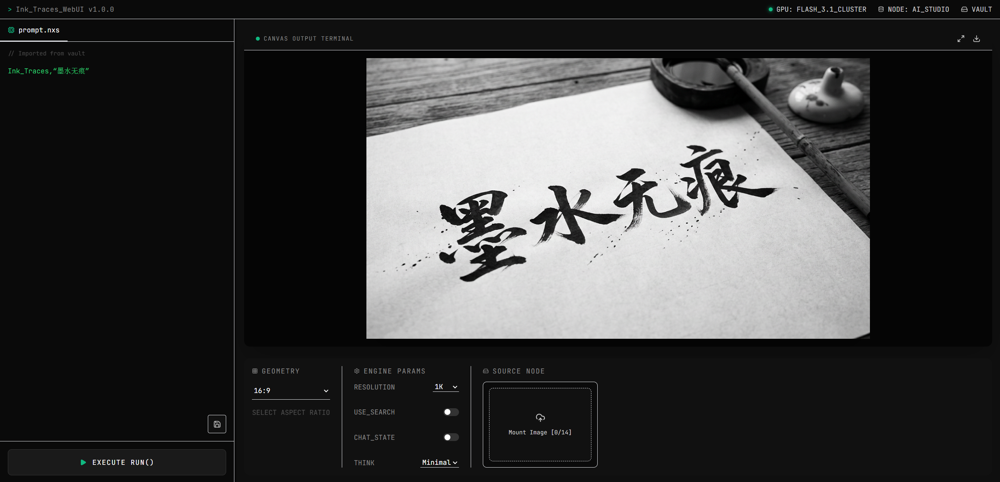

# Ink Traces WebUI

<p align="center">
  
</p>

<p align="center">
  <strong>桌面优先的 AI 图片、视频、音频生成与图层编辑工作台，按 项目 → 画布 → 节点 组织创作。</strong>
</p>

<p align="center">
  <a href="../README.md">English</a> · 中文
</p>

<p align="center">当前版本 1.2.0 · <a href="../CHANGELOG.md">更新日志</a></p>

<p align="center">
  
</p>

## 主要功能

- **画布工作流**：一个项目下有多个画布；图像、视频、音频生成节点可拖动、编辑并连线。上游结果和素材库素材作为显式参考输入（含视频接视频），生成只在用户触发时运行。
- **素材库**：项目素材、素材组与本地素材（用户上传保存为独立持久副本），支持全选与永久删除。
- **任务中心**：每次生成都是真实后端任务，支持服务端搜索、分页、收藏、回收站与批量下载。
- **图层工作台**：把图片分解为 2–100 个可编辑图层，可选 OCR，支持版本恢复与导出。
- **接口管理**：可保存多套命名配置，按节点单独选择，项目可设默认；已提交任务固定配置版本。
- **防重复计费**：Provider 请求超时、结果未知时不会自动重放，避免重复付费生成。
- **Prompt Vault**：可复用的提示词收藏与全屏编辑器。

## 支持的接口

| 能力 | Provider |
|---|---|
| 图片 | BytePlus Ark（Seedream 5.5）、Cupsy |
| 视频 | BytePlus Ark（Seedance）、Cupsy |
| 音频 | Cupsy（Seed Audio） |
| 图层分解 | BytePlus Ark |

## 快速开始

环境：Python 3.10+、Node.js 18+，以及至少一个 Provider 的 API 凭据。

```bash
cp config.json.example config.json   # 然后填入你的凭据
./setup.sh                           # 安装前后端依赖
./start.sh                           # 构建前端，启动 Worker 与 Gunicorn
```

浏览器访问 <http://localhost:4545>，用 `./stop.sh` 停止。完整说明（HTTPS、systemd、维护）见 [INSTALL.md](../INSTALL.md)。

## 配置要点

- 密钥只放在本地 `config.json`，该文件已被 Git 忽略，切勿提交。
- `config.json` 使用 v2 格式（`"config_version": 2`）：账号放 `providers.byteplus` / `providers.cupsy`，各能力使用的模型放 `generation`，部署项放 `deployment`。配置无效或为旧格式时服务拒绝启动，可用 `python3 server/config_v2.py check` 校验；详见[技术与运行说明](development.md#配置configjson-v2)。
- Ark 的 Seedance 2.5 需在 `providers.byteplus.endpoint_ids.seedance_2_5` 填写你自己的接入点 ID（BytePlus 控制台的 `ep-…`）；模板只提供占位值，未替换时提交会被拒绝。
- Cupsy 通过公网 HTTP(S) 地址回源获取参考素材：设置 `deployment.cupsy_source.base_url`（建议 HTTPS），详见 [Cupsy 适配说明](cupsy_compatibility.md)。
- 受控部署请设置 `auth.secret_key`（或环境变量 `INK_TRACES_SECRET_KEY`）。
- 图层使用 BytePlus 图片模型（`generation.image.byteplus.model`），无独立配置。
- 图层工作台用法见[图层工作台说明](layer-studio.md)，运行性能见[性能说明](performance.md)。

## 开发与测试

测试默认使用 mock Provider，不会发起付费请求。后端测试需在不含 `config.json` 的检出目录中运行：

```bash
pip install -r server/requirements-dev.txt
pytest
cd client && npm install && npm run build   # 前端构建检查
```

前端热更新：`NANOBANANA_FRONTEND_MODE=dev ./start.sh`。

## 项目结构

| 路径 | 内容 |
|---|---|
| `client/` | React 18 + Vite + Tailwind 前端 |
| `server/` | Flask API、任务 Worker、SQLite 存储与测试 |
| `deploy/` | Nginx / Certbot / HTTPS 辅助脚本 |
| `doc/` | 中文 README 与专题说明 |
| `config.json.example` | 配置模板 |
| `setup.sh` `start.sh` `stop.sh` `clean.sh` | 安装、启停与缓存清理 |

## License

本项目以 MIT 许可证发布，详见 [LICENSE](../LICENSE)。
